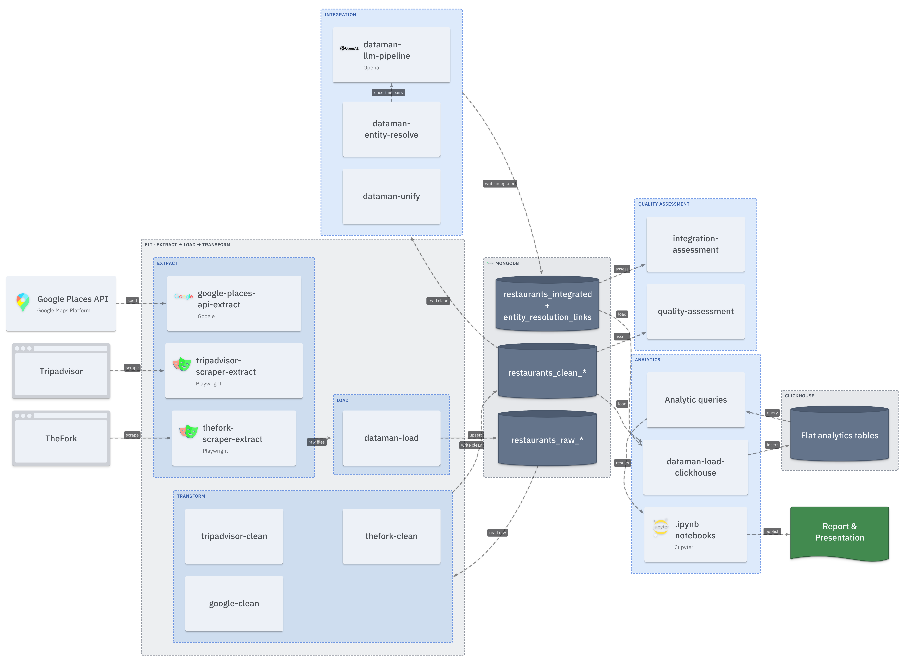

# Milan Restaurant Ratings

### A reproducible data-management pipeline for comparing Google, Tripadvisor, and TheFork

[](https://github.com/Laimon99/data-management-project/actions/workflows/ci.yml)
[](https://www.python.org/)
[](LICENSE)

This University of Milan-Bicocca project builds an end-to-end pipeline for studying
how restaurant ratings differ across three online platforms in the Milan area. It
covers acquisition, raw storage, schema transformation, entity resolution, data
integration, quality assessment, analytical serving, and eleven research questions.

[Final report](deliverables/reports/data-management-project-report.pdf) ·
[Presentation](deliverables/presentations/data-management-project-presentation.pdf) ·
[Results](docs/RESULTS.md) ·
[Reproduction guide](REPRODUCTION_OF_PROJECT.md)



## Project at a glance

| Area | Implementation |
|---|---|
| Sources | Google Places API, Tripadvisor, TheFork |
| Storage | MongoDB system of record; ClickHouse analytical layer |
| Integration | Deterministic/fuzzy entity resolution with optional LLM adjudication |
| Data quality | Pre- and post-integration profiling, calibration, and error analysis |
| Analysis | Externalized SQL plus twelve Jupyter notebooks (overview + Q1–Q11) |
| Final snapshot | 10,054 integrated restaurants from 10,808 Google, 7,539 Tripadvisor, and 1,344 TheFork records |
| Verification | 475 automated tests; Ruff lint/format checks in GitHub Actions |

## Architecture

The pipeline is organized into independently testable stages:

1. **Extract** — Google Places seed acquisition and checkpointed Playwright scrapers.
2. **Load** — idempotent raw-document upserts into MongoDB.
3. **Transform** — source-specific cleaning and schema normalization.
4. **Resolve and unify** — geographic/fuzzy candidate matching, calibrated decisions,
   optional LLM review of uncertain pairs, and an integrated restaurant model.
5. **Assess** — source quality, entity-resolution error, link survival, and geocoding
   quality reports.
6. **Analyze** — flat ClickHouse tables, reusable SQL builders, notebooks, charts, and
   publication-ready tables.

The editable architecture model is in [`diagrams/`](diagrams/); generated renders are
in [`artifacts/diagrams/`](artifacts/diagrams/). The detailed design is documented in
[`docs/PIPELINE.md`](docs/PIPELINE.md).

## Main findings

- Google and TheFork ratings agree more closely; Tripadvisor is systematically lower
  in the matched comparisons.
- Sparse review counts increase rating volatility rather than the mean rating itself.
- Data completeness decreases with distance from central Milan, while the tourist core
  is rated about 0.2 stars lower than the 2–4 km belt.
- Multi-platform presence is strongly associated with popularity, but only weakly with
  rating level.
- Photo volume follows review activity far more than restaurant rating.

See [`docs/RESULTS.md`](docs/RESULTS.md) for all Q1–Q11 conclusions, metrics, caveats,
and links to the generated evidence.

## Quick start

Install [`uv`](https://docs.astral.sh/uv/), clone the repository, and run the local
quality gate:

```bash
git clone https://github.com/Laimon99/data-management-project.git
cd data-management-project
uv sync --extra dev
uv run ruff check .
uv run ruff format --check .
uv run pytest
```

The tests use mocks and small fixtures; they do not require API keys, browsers, or
running databases.

For the complete pipeline, install the analysis dependencies and start MongoDB:

```bash
uv sync --extra dev --extra analysis
docker compose up -d mongo
```

The showcase branch intentionally excludes complete raw and processed datasets. Use
the public sample in [`data/samples/`](data/samples/) for schema inspection, then follow
[`REPRODUCTION_OF_PROJECT.md`](REPRODUCTION_OF_PROJECT.md) to collect or restore the
inputs needed for an end-to-end run.

## Repository map

| Path | Purpose |
|---|---|
| [`services/`](services/) | Extract, load, transform, assessment, and analysis packages |
| [`tests/`](tests/) | Unit and integration tests mirroring the service layout |
| [`notebooks/`](notebooks/) | Overview and Q1–Q11 analytical notebooks |
| [`data/`](data/) | Public sample, aggregate metrics, and data inventory |
| [`docs/`](docs/) | Architecture, decisions, methods, results, and historical context |
| [`report/`](report/) | Editable LaTeX report sources |
| [`deliverables/`](deliverables/) | Final reports and presentations |
| [`artifacts/`](artifacts/) | Generated tables, HTML analysis, and diagram renders |

## Team

- Edoardo Zero
- Simone Ragusini
- Vladyslav Yelisieiev

The project was developed collaboratively for the Data Management course at the
University of Milan-Bicocca, academic year 2025/2026. All three authors remain credited
in the repository history, report, presentation, and [`CITATION.cff`](CITATION.cff).

## License and data terms

Original code and documentation are released under the [MIT License](LICENSE).
Third-party platform data is excluded from that grant. Before collecting, downloading,
or reusing any dataset, read [`DATA_USAGE.md`](DATA_USAGE.md).

The complete course-submission tree is preserved on
[`backup/academic-submission-2026-08-27`](https://github.com/Laimon99/data-management-project/tree/backup/academic-submission-2026-08-27).
The original long-form README and historical checklist are archived in
[`docs/archive/ACADEMIC_README.md`](docs/archive/ACADEMIC_README.md).
